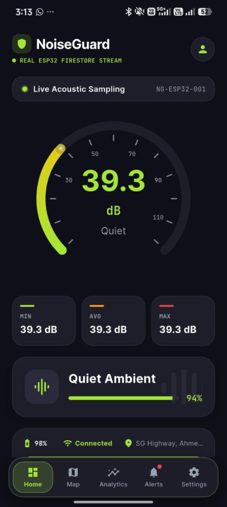
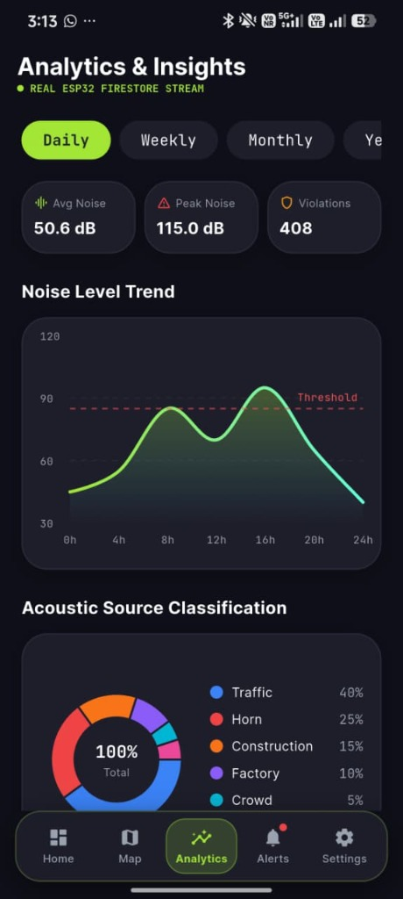
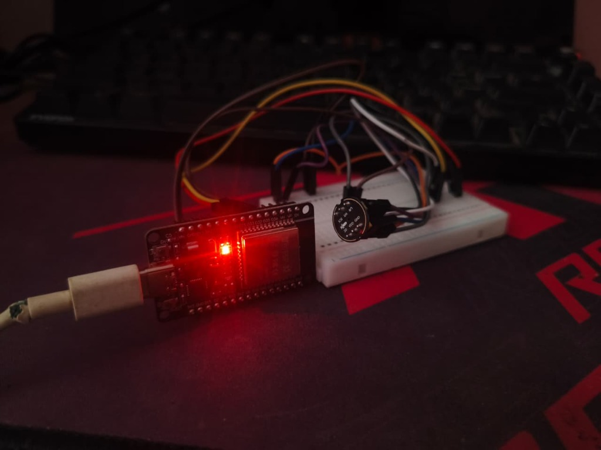
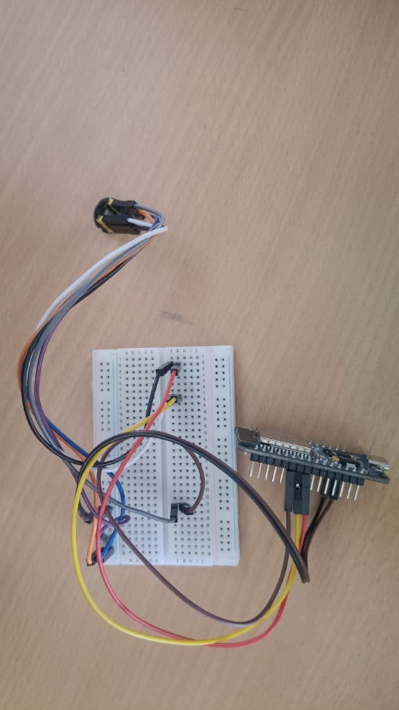

# NoiseGuard — AI-Powered Smart Noise Pollution Monitoring & Alert System

[](https://flutter.dev)
[](https://espressif.com)
[](https://firebase.google.com)
[](https://ai.google.dev)
[](LICENSE)

An end-to-end IoT, Edge-AI, and Mobile system designed for real-time acoustic monitoring, on-device sound classification, municipal noise violation detection, and AI-driven policy insights.

---

## 📸 Implementation & Live Working

### 1. Mobile Application in Action
<p align="center">
  
  &nbsp;&nbsp;&nbsp;&nbsp;
  
</p>

- **Live Acoustic Sampling (Left)**: Connected in real-time to the ESP32 node (`NG-ESP32-001`) via Cloud Firestore, accurately measuring ambient quiet room SPL at **39.3 dB** with **94% confidence** for "Quiet Ambient".
- **Analytics & Insights (Right)**: Real-time telemetry processing displaying daily trend curves, violation tracking (408 events detected), peak level capture (115.0 dB), and TinyML acoustic source breakdown (**Traffic 40%**, **Horn 25%**, **Construction 15%**, **Factory 10%**, **Crowd 5%**).

---

### 2. Edge Hardware Node
<p align="center">
  
  &nbsp;&nbsp;&nbsp;&nbsp;
  
</p>

- **Active ESP32 Node (Left)**: Running continuous <10ms I2S audio DSP, 512-point FFT, and TinyML classification with live power and status indicators.
- **Hardware Prototyping Setup (Right)**: INMP441 omnidirectional MEMS digital microphone module interfaced via I2S bus (GPIO 32, 25, 33) on breadboard with dedicated power rails.

---

## 🏛️ System Architecture

```
[ INMP441 MEMS Mic ] 
       │ (I2S Digital Audio, 16 kHz)
       ▼
[ ESP32 Edge Device ]
       ├─ Continuous DSP (<10ms): Decibel SPL & 512-pt FFT
       ├─ Edge TinyML Classifier: Voice, Horn, Siren, Traffic, Construction, Music
       ├─ Local Actuators (Zero-Latency): Red LED (GPIO 18) & Buzzer (GPIO 21)
       └─ Telemetry Sync (every 2s): Decibels, Peak Hold, Spectral Profile
               │
               ▼
[ Cloud Infrastructure (Firebase) ]
       ├─ Realtime Database: Instant telemetry streaming (<100ms)
       ├─ Cloud Firestore: Historical noise records, alerts & spatial telemetry
       └─ Firebase Auth & Security Rules
               │
               ▼
[ Flutter Cross-Platform Mobile App ]
       ├─ Live Animated dB Circular Gauge & Sound Wave Spectrum
       ├─ Google Maps Geospatial Heatmap & Sensor Marker Clusters
       ├─ Google Gemini 1.5 Flash AI Engine:
       │    ├─ Violation Diagnostic Analysis (Acoustic fingerprinting)
       │    └─ Daily Executive Briefings & Civic Mitigation Recommendations
       ├─ Automated Incident PDF Reports (Sharing & Export)
       └─ Push Notifications & Municipal Area Threshold Enforcement
```

---

## ✨ Key Features

- **Accurate Decibel SPL Calibration**: Calibrated RMS-to-decibel formula ($20 \log_{10}(\text{RMS}) - 14.0\text{ dB}$) providing reliable SPL readings (38–45 dB Quiet Room, 55–65 dB Conversation, 80+ dB Loud Spikes).
- **Edge TinyML Sound Classifier**: Runs on ESP32 without internet dependency:
  - 🗣️ **Voice / Speech** (300–3000 Hz mid-band dominant energy)
  - 🚗 **Traffic** (Low-frequency rumble < 500 Hz)
  - 📢 **Vehicle Horn** (Tonal peak 350–1300 Hz, low flatness)
  - 🚨 **Siren** (High zero-crossing rate + centroid > 1400 Hz)
  - 🔨 **Construction** (Broadband impulsive, high crest factor > 4.5)
  - 🎵 **Music / DJ** (Balanced harmonics, high energy)
- **Windowed Peak Tracking**: Real-time continuous sampling buffers maximum acoustic peaks over 2000ms intervals to capture transient spikes (honking, machinery).
- **Google Gemini 1.5 Flash Integration**:
  - Automatically assesses acoustic spectral parameters (Spectral Centroid, Flatness, Crest Factor, Energy Distribution) during violation events.
  - Generates human-readable incident summaries and civic actionable recommendations.
- **Geospatial Noise Heatmaps**: Interactive Google Maps interface with dynamic weighted heatmap overlays.
- **Automated PDF Incident Reports**: Generates downloadable PDF reports summarizing daily averages, peaks, violation logs, and threshold comparisons.

---

## 🔌 Hardware Wiring & Pinout

For full schematics and step-by-step wiring instructions, see [WIRING.md](WIRING.md).

| Hardware Component | ESP32 Pin | Function |
|-------------------|-----------|----------|
| **INMP441 VDD** | **3V3** | 3.3V Power |
| **INMP441 GND & L/R** | **GND** | Ground (L/R tied to GND for Left Channel) |
| **INMP441 SD** | **GPIO 32** | I2S Serial Data |
| **INMP441 WS** | **GPIO 25** | I2S Word Select (LRCLK) |
| **INMP441 SCK** | **GPIO 33** | I2S Bit Clock (BCLK) |
| **Red LED** | **GPIO 18** | Noise Violation Indicator |
| **Green LED** | **GPIO 19** | Wi-Fi Connected Status |
| **Active Buzzer** | **GPIO 21** | Audible Alarm |

---

## 🚀 Getting Started

### 1. ESP32 Firmware

1. Install [Arduino CLI](https://arduino.github.io/arduino-cli/) or Arduino IDE.
2. Install the ESP32 board support and required libraries:
   ```bash
   arduino-cli lib install "ArduinoJson"
   arduino-cli lib install "arduinoFFT"
   ```
3. Open `firmware/noiseguard_esp32/noiseguard_esp32.ino`.
4. Configure your Wi-Fi credentials:
   ```cpp
   char wifiSSID[] = "YOUR_WIFI_SSID";
   char wifiPassword[] = "YOUR_WIFI_PASSWORD";
   ```
5. Compile and upload:
   ```bash
   arduino-cli compile --fqbn esp32:esp32:esp32 firmware/noiseguard_esp32
   arduino-cli upload -p COM3 --fqbn esp32:esp32:esp32 firmware/noiseguard_esp32
   ```

### 2. Flutter Mobile Application

1. Ensure Flutter SDK (>=3.0) is installed:
   ```bash
   flutter doctor
   ```
2. Get project dependencies:
   ```bash
   flutter pub get
   ```
3. Run on connected mobile device or emulator:
   ```bash
   flutter run
   ```
4. Or build the APK:
   ```bash
   flutter build apk --debug
   ```

---

## 📄 License

This project is licensed under the MIT License - see the [LICENSE](LICENSE) file for details.
